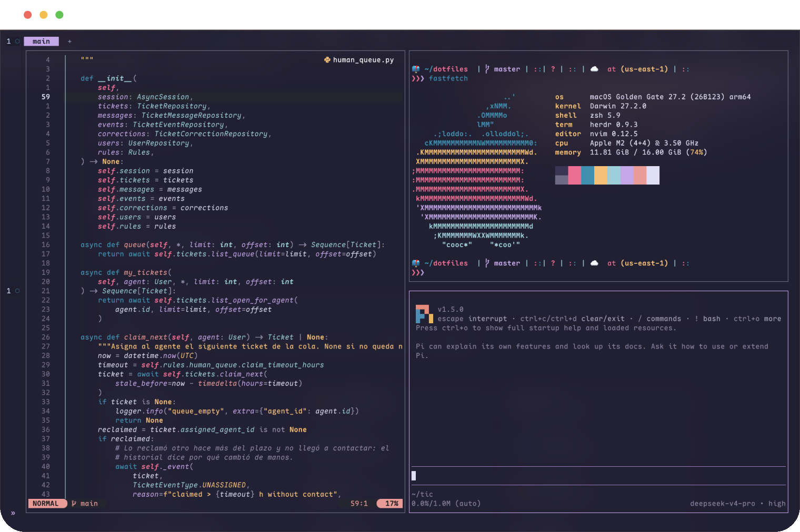

# Dotfiles

My terminal-centric development environment: Ghostty, zsh, Neovim, and a few AI tools, all themed with Rosé Pine. I use it every day on a MacBook. My other computer runs Fedora, my Linux distro of choice, so the repository also includes an install script for it.

Every folder in this repository is a [GNU Stow](https://www.gnu.org/software/stow/) package, so a single `stow <name>` links that tool's config into `$HOME`.

> [!NOTE]
> This is my personal setup, tuned to my own workflow.
>
> Feel free to borrow anything, but read each config before stowing it instead of linking everything at once.



## What this sets up

| Area | Current choice |
|------|----------------|
| Dotfile management | GNU Stow, one package per tool |
| Terminal | Ghostty with transparency, blur, and custom cursor shaders |
| Shell and prompt | zsh with autosuggestions and syntax highlighting, Starship, and zoxide |
| Runtime versions | mise (Go, Python, Terraform, uv) |
| Multiplexer | herdr |
| Editor | Neovim with LazyVim, plus Zed as a secondary editor |
| AI tools | Claude Code (via claudecode.nvim), Pi, and minuet-ai inline completion with DeepSeek |
| System info | fastfetch with a minimal module list |
| Fonts and color | Maple Mono and Rosé Pine |

## Ghostty cursor shaders

Ghostty draws an animated trail when the cursor moves. The shaders live in `ghostty/.config/ghostty/shaders/`:

| Shader | Effect |
|--------|--------|
| `cursor_personal.glsl` | **Active.** Trail in the Rosé Pine colors pine, iris, and love (0.2 s) |
| `cursor_blink.glsl` | Short trail in Rosé Pine foam and iris (0.1 s) |
| `cursor_starwars.glsl` | Cyan and blue trail (0.3 s) |
| `cursor_white.glsl` | Subtle, semi-transparent trail (0.1 s) |

To switch shaders, change this line in `ghostty/.config/ghostty/config` and reload Ghostty:

```ini
custom-shader = ./shaders/cursor_personal.glsl
```

Each file sets its duration in `DURATION`. The colors are in `TRAIL_COLOR`, or in the `colors` array in `cursor_personal.glsl`. The shaders are based on Inigo Quilez's [2D distance functions](https://iquilezles.org/articles/distfunctions2d/), and `cursor_personal.glsl` is a contribution by [PremModhaOfficial](https://github.com/PremModhaOfficial).

## Install

### 1. Clone the repository

```bash
git clone https://github.com/cristoge/dotfiles.git ~/dotfiles
cd ~/dotfiles
```

### 2. Install the packages

**macOS** (requires [Homebrew](https://brew.sh)):

```bash
brew install git stow neovim starship zoxide fzf ripgrep fd lazygit eza mise fastfetch luarocks herdr
brew install --cask ghostty zed font-maple-mono claude-code
```

**Fedora**:

```bash
./script.sh
```

### 3. Link the configs

```bash
stow zsh nvim ghostty starship herdr zed
```

Stow only the packages you need. It refuses to overwrite existing files, so back up or remove any previous config first.

### 4. Extra requirements

- **zsh plugins**: `.plugins.zsh` loads them from `~/.zsh/`, so clone them there:

  ```bash
  git clone https://github.com/zsh-users/zsh-autosuggestions ~/.zsh/zsh-autosuggestions
  git clone https://github.com/zsh-users/zsh-syntax-highlighting ~/.zsh/zsh-syntax-highlighting
  ```
