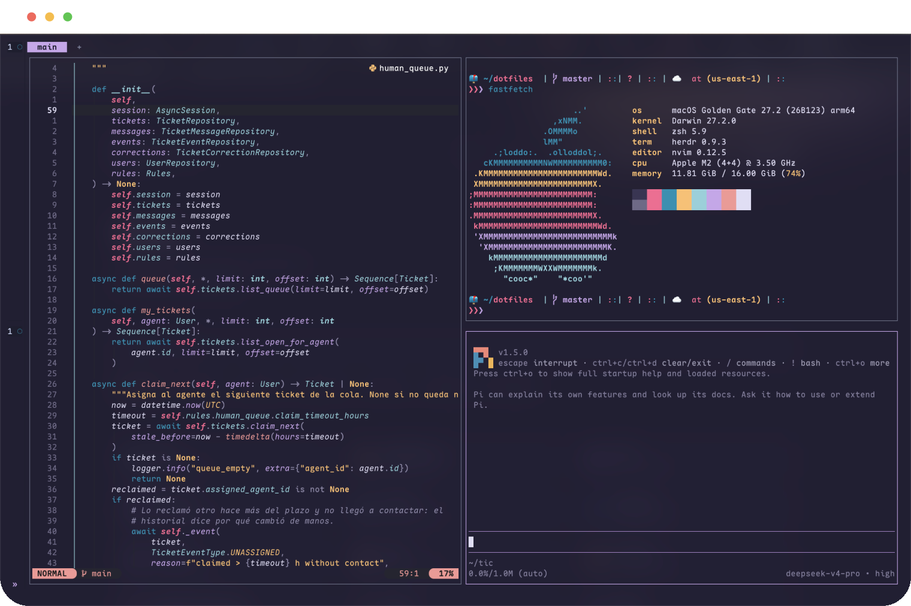

# Dotfiles

My terminal-centric development environment: Ghostty, zsh, Neovim, Zed, and a few AI tools. Ghostty, herdr, Starship, and Neovim use Vague; Zed uses Catppuccin Espresso in dark mode. I use this setup every day on a MacBook. My other computer runs Fedora, my Linux distro of choice, so the repository also includes an install script for it.

Each tool's configuration directory is a [GNU Stow](https://www.gnu.org/software/stow/) package, so a single `stow <name>` from `~/dotfiles` links that tool's config into `$HOME`.

> [!NOTE]
> This is my personal setup, tuned to my own workflow.
>
> Feel free to borrow anything, but read each config before stowing it instead of linking everything at once.



## What this sets up

| Area | Current choice |
|------|----------------|
| Dotfile management | GNU Stow, one package per tool |
| Terminal | Ghostty with transparency, blur, and custom cursor shaders |
| Shell and prompt | zsh with autosuggestions and syntax highlighting, Starship, and zoxide |
| Runtime versions and CLI tools | mise (Node.js, Python, Go, Terraform, pnpm, uv, AWS CLI) |
| Multiplexer | herdr with its sidebar hidden at startup |
| Editor | Neovim with LazyVim, plus Zed with Vim mode |
| AI tools | Pi, Codex, and Claude Code |
| System info | fastfetch with a minimal module list |
| Fonts and color | Maple Mono, Geist Mono in Zed, Vague, and Catppuccin Espresso |

## Ghostty cursor shaders

Ghostty draws an animated trail when the cursor moves. The shaders live in `ghostty/.config/ghostty/shaders/`:

| Shader | Effect |
|--------|--------|
| `cursor_personal.glsl` | **Active.** Trail in Vague teal, mauve, and yellow (0.2 s) |
| `cursor_blink.glsl` | Short trail in Rosé Pine foam and iris (0.1 s) |
| `cursor_starwars.glsl` | Cyan and blue trail (0.3 s) |
| `cursor_white.glsl` | Subtle, semi-transparent trail (0.1 s) |

To switch shaders, change this line in `ghostty/.config/ghostty/config` and reload Ghostty:

```ini
custom-shader = ./shaders/cursor_personal.glsl
```

Each file sets its duration in `DURATION`. The colors are in `TRAIL_COLOR`, or in the `colors` array in `cursor_personal.glsl`. The shaders are based on Inigo Quilez's [2D distance functions](https://iquilezles.org/articles/distfunctions2d/), and `cursor_personal.glsl` is a contribution by [PremModhaOfficial](https://github.com/PremModhaOfficial).

## Install

### 1. Clone the repository

```bash
git clone https://github.com/cristoge/dotfiles.git ~/dotfiles
cd ~/dotfiles
```

### 2. Install the packages

**macOS** (requires [Homebrew](https://brew.sh)):

```bash
brew install git stow neovim starship zoxide fzf ripgrep fd lazygit eza mise fastfetch luarocks herdr
brew install --cask ghostty zed font-maple-mono claude-code
```

**Fedora**:

```bash
./script.sh
```

The script updates the system and installs the base CLI tools, Neovim, mise, lazygit, Ghostty, Starship, and Zed. It enables the `jdxcode/mise`, `dejan/lazygit`, and `scottames/ghostty` COPR repositories. Python tooling is managed through mise rather than pipx.

The Fedora script is not a complete equivalent of the Homebrew commands: zsh, fastfetch, herdr, Maple Mono, and Claude Code must be installed separately if needed.

### 3. Link the configs

```bash
stow zsh nvim ghostty starship herdr zed mise
```

Stow only the packages you need. It refuses to overwrite existing files, so back up or remove any previous config first.

### 4. Install the configured tool versions

[mise](https://mise.jdx.dev/) reads the versions from `mise/.config/mise/config.toml`, linked to `~/.config/mise/config.toml` by Stow. The current configuration selects Node.js 24, Python 3.15, Go 1.27, Terraform 1.17, and the latest pnpm, uv, and AWS CLI.

mise is installed in step 2 on both platforms: through Homebrew on macOS and the `jdxcode/mise` COPR repository on Fedora. Linking its config alone does not install the configured tool versions.

Once mise is available on your `PATH`, add this line to your `~/.zshrc` so it activates automatically in each new zsh session. The checked-in zsh config does not include it:

```bash
eval "$(mise activate zsh)"
```

Then reload your zsh configuration and install the configured tools:

```bash
source ~/.zshrc
mise install
```

### 5. Extra requirements

- **zsh plugins**: `.plugins.zsh` loads them from `~/.zsh/`, so clone them there:

  ```bash
  git clone https://github.com/zsh-users/zsh-autosuggestions ~/.zsh/zsh-autosuggestions
  git clone https://github.com/zsh-users/zsh-syntax-highlighting ~/.zsh/zsh-syntax-highlighting
  ```

## Editors

Neovim uses LazyVim with the Vague colorscheme.

Zed uses its default base keymap with Vim mode, relative line numbers, format on save, and autosave on focus change. Its tab bar and scrollbar are hidden, and the project panel is docked on the right. The interface, editor, and terminal use Geist Mono.

The custom bindings in `zed/.config/zed/keymap.json` are:

| Context | Shortcut | Action |
|---------|----------|--------|
| Vim normal mode | `Ctrl-H/J/K/L` | Focus the pane to the left, below, above, or right |
| Vim visual mode | `Shift-S` | Add surrounding characters to the selection |

Zed's settings configure DeepSeek edit predictions and the Codex ACP agent. The global `zed/.config/zed/tasks.json` contains an example shell task to adapt to your workflow.

## Pi

The optional `pi` Stow package configures [Pi](https://pi.dev/) with [Gentle AI](https://www.npmjs.com/package/gentle-pi) through `npm:gentle-pi`. Its settings live in `pi/.pi/agent/settings.json`.

The configuration uses fullscreen mode, disables the package's startup banner, and includes its agent-status, tokens-per-second, and Gentle Shell extensions. Package themes are disabled with `themes: []`, leaving Pi's default `system` theme in use. Pi's built-in codemode extension is disabled.

Pi is not installed by the package commands or Fedora script above. Install it separately using the [official instructions](https://pi.dev/) and make sure `npm` is on your `PATH`, then link its configuration:

```bash
stow pi
```

Back up any existing `~/.pi/agent/` configuration before linking. Stow refuses conflicting files; do not overwrite your active configuration without reviewing the differences. The package contains portable settings only, not credentials, session history, installed package files, or a machine-specific device ID.

Pi installs the declared npm package when needed at startup. The package version is not pinned, matching the current setup. Configure your AI provider separately inside Pi with `/login`.

The optional [minimal status-bar patch](pi/.pi/agent/patches/README.md) saves the thin green/orange/red gauges and hidden monetary segment while retaining the system theme. It targets Gentle Pi 4.8.0 and must be checked and reapplied manually after an update; Stow does not apply it.

## Local files ignored by Git

The [`.gitignore`](.gitignore) excludes local runtime files from the Stow packages:

| Tool | Ignored files |
|------|---------------|
| herdr | Plugin lock, logs, current session, and session snapshots |
| Zed | The local `prompts/` database directory |
| Pi | Authentication, model-store state, sessions, installed binaries and packages, and generated Gentle AI and ACP state |

Pi's `settings.json` and optional patches remain versioned. Ignore rules apply to untracked files; files already tracked by Git must be removed from its index separately to stop versioning them.
